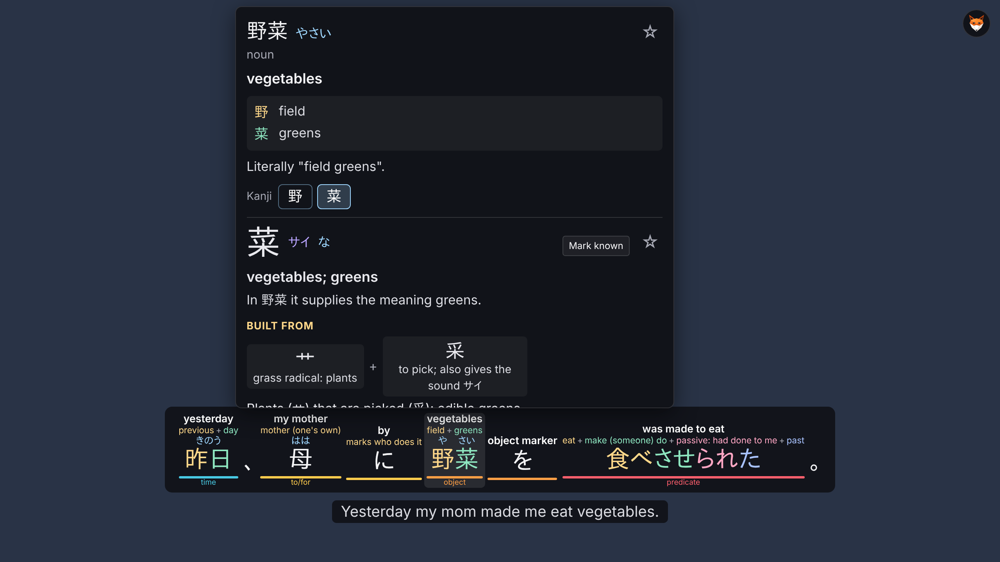
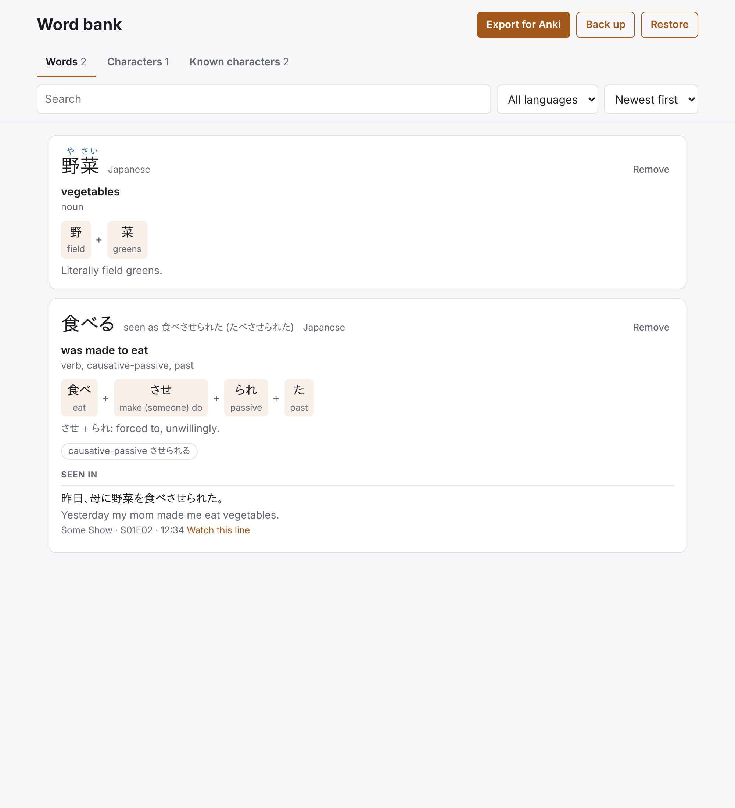
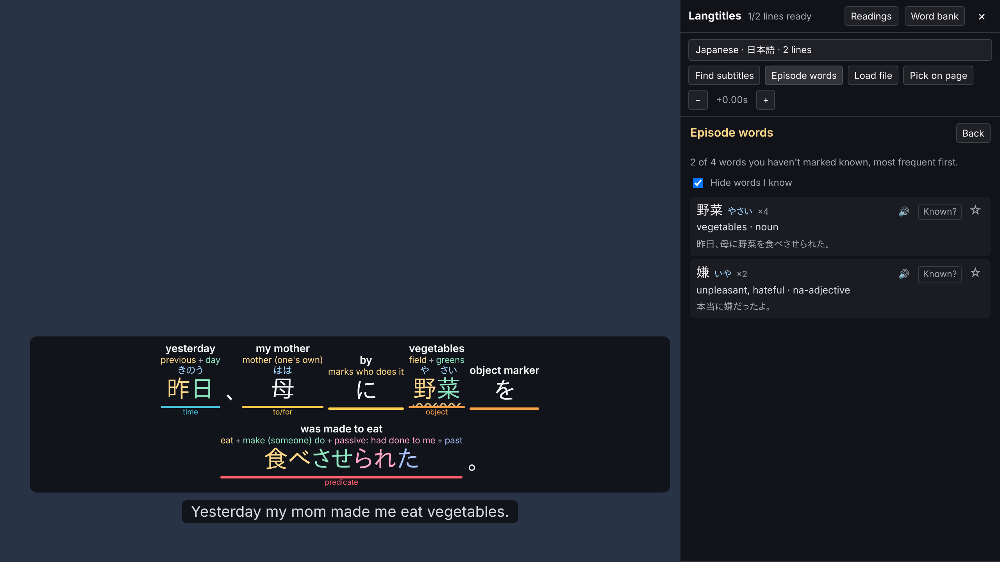
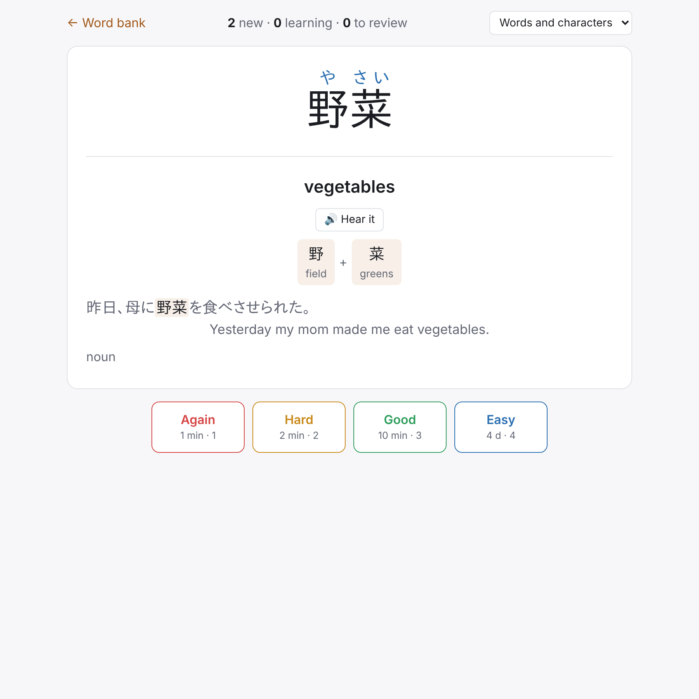
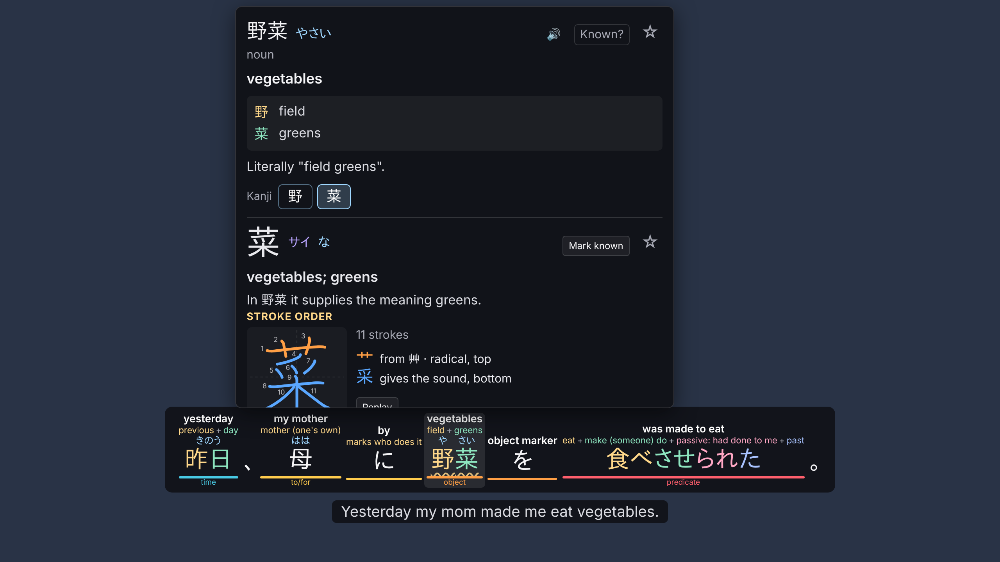
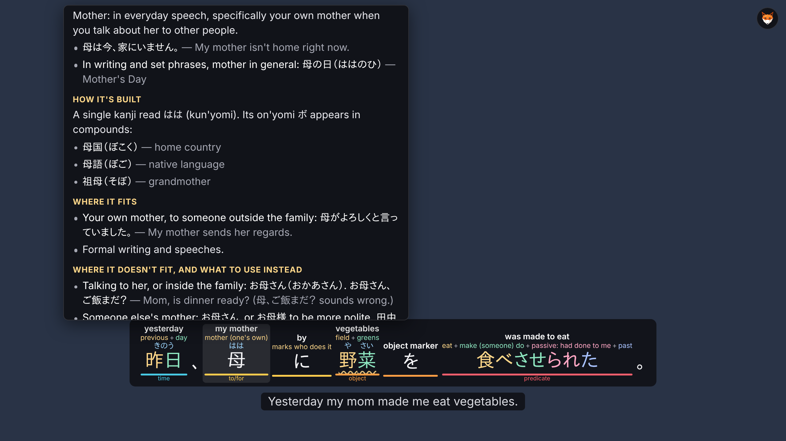
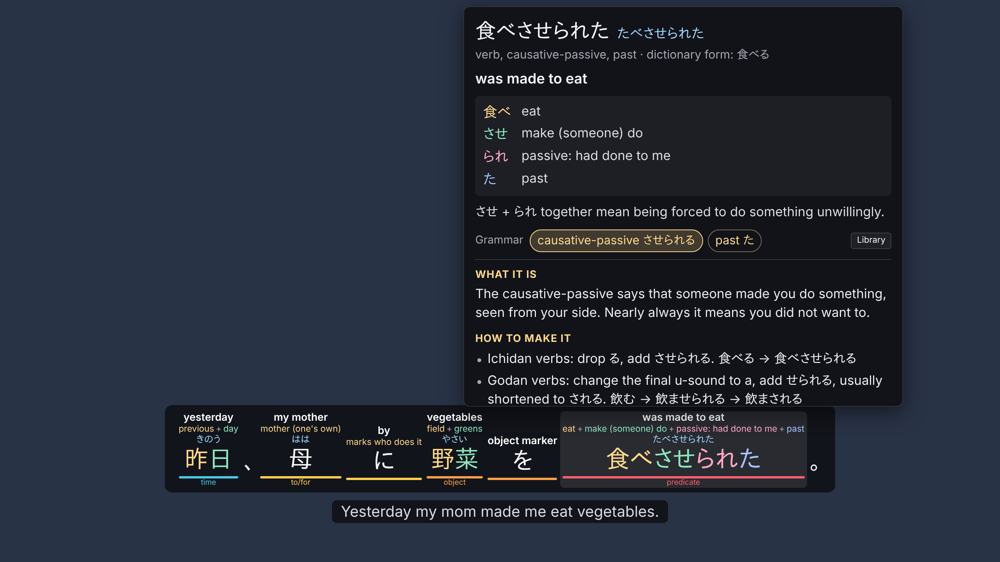
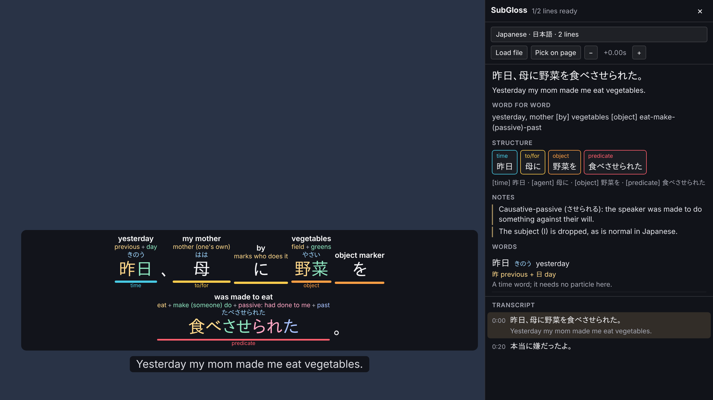
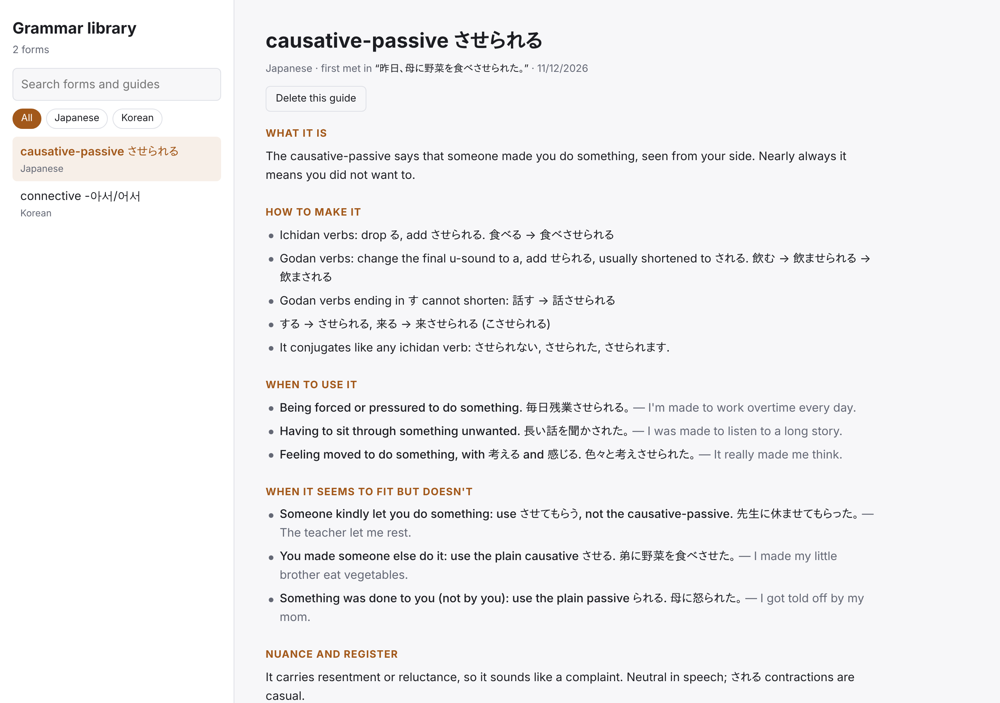
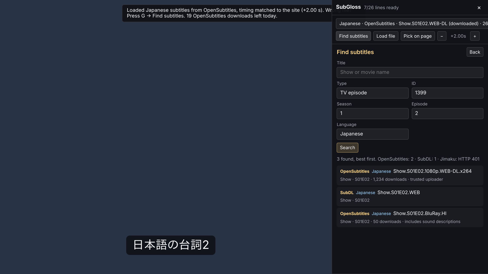

# Langtitles


A Firefox extension that turns the subtitles on any streaming site into a word-by-word breakdown, written by Claude.

Above every word you see its best translation for this sentence, and its reading. Click (or rest on) a word for the rest: the pieces it is built from with what each piece does (`食べ eat + させ make/let (causative) + られ be done to (passive) + た past`), other meanings, notes and guides. The pieces can also be shown above the words (Show → Pieces). Under each phrase, a coloured bar shows its job in the sentence (topic, object, predicate…). Hovering a word pauses the video and opens a note. A side panel shows the translation, a literal word-for-word rendering, the sentence structure, grammar notes and a clickable transcript.

## Furigana and pinyin

Japanese gets hiragana over each kanji, and Chinese gets pinyin over each character. There is no romanization, for Korean or anything else. Furigana is left off kanji you have marked as known, and pinyin off characters you've marked, unless you turn that off in Options. Press **R** while watching (or **Readings** in the side panel) to switch readings on or off.

## Word bank and characters

- Hover a word and click **☆** to save it, along with the line, its translation, the show and the timestamp. Saving the same word from another line adds that line as another example. The side panel's word list has stars too.
- Every kanji or hanzi in a word appears as a chip in the hover popup. Click one for its own entry: meanings, readings and when each is used, the components it is built from (`艹 grass + 采 pick`), common words that use it, and notes. Entries are written once per character and saved. From there, **☆** saves the character and **Mark known** stops furigana over it.
- **Word bank** (toolbar button, or the panel) lists saved words and characters. You can search them, jump back to the moment a line was said ("Watch this line"), and manage known characters. Paste any text, such as a JLPT kanji list, to mark all its kanji as known at once.
- **Export for Anki** writes a file Anki imports directly (File → Import), including furigana in Anki's format. **Back up** and **Restore** move everything to another browser.




## Korean, Chinese and Japanese together

- **Hanja over Korean.** Sino-Korean words show their hanja over each syllable (학교 with 學校 above), like furigana. No romanization.
- **The same word in your other languages.** The hover popup lists the same word in the other two of Japanese, Chinese and Korean (학교 → 学校 がっこう, 学校 xuéxiào), with any difference in meaning (野菜 is "vegetables" in Japanese but "wild herbs" in Chinese).
- **Tone colours.** Pinyin is coloured by tone: 1 red, 2 green, 3 blue, 4 purple, neutral grey.
- **Pitch accent.** Japanese words show their pitch pattern in the hover popup, word lists and review, drawn as a line over the kana with the accent number (はし [1] chopsticks, はし [2] bridge). Data: [Kanjium](https://github.com/mifunetoshiro/kanjium) (CC BY-SA 4.0), downloaded once.
- **How a word builds up.** For an inflected word, the hover popup shows the chain: 食べる eat → 食べさせる make (someone) eat → 食べさせられる be made to eat → 食べさせられた was made to eat. Grammar pieces carry short, consistent labels ("make/let (causative)", "be done to (passive)", "past") so you learn to recognise them.

## Ask about a line

Under each line in the side panel, ask anything ("why は and not が here?", "could I say this to my boss?"). Claude answers with the line, the lines around it and the scene in mind, and you can ask follow-up questions.

## Studying while you watch

- **Words you know stay plain.** Mark a word **Known?** in the hover popup (の, は and other words you already know) and the meaning and pieces above it disappear wherever it appears; hovering still shows everything. This can be turned off in Options.
- **New words underlined.** Mark words you know with **Known?** in the hover popup, with **Mark every word known** for a line in the side panel, or by learning them in review. Once 20 words are known in a language, words you don't know yet get a wavy underline.
- **Pause on one new word** (optional, in Options). After a line with exactly one new word, the video pauses with that word shown, since those lines are often the easiest to learn from.
- **Slow replay.** **S** replays the current line at 0.75× (the speed is adjustable), and **L** loops it until you press L again.
- **Pronunciation.** 🔊 in the hover popup, the side panel, the word bank and review reads a word or line aloud. It uses the voices installed on your computer: if one is missing, Langtitles says how to add it.
- **Episode words.** Side panel → **Episode words** lists the words of the whole episode you haven't marked known, most frequent first, with an example line you can jump to. It costs one Claude request per episode, and the list is saved.



## Review

**Review** (toolbar button, word bank, or the panel's Word bank) turns saved words, characters, whole lines (☆ Save line in the side panel) and grammar forms into flashcards with spaced repetition: Again, Hard, Good or Easy schedule the next review (Space shows the answer, keys 1 to 4 grade it). Word cards show the word in the line you met it; the answer adds furigana, meaning, pieces, the translation and audio. Character cards add stroke order. Line cards show the line, then its translation and word-by-word breakdown. Grammar cards are a new fill-in-the-blank sentence each time, written by Claude, and about one time in three the right answer is a form often confused with the one you are studying, so you practise where it does not fit as well as where it does. Grammar forms are added automatically when you open their guide (this can be turned off). New cards per day can be set in Options. Words and characters you've learned (reviewed every 21 days or longer) count as known automatically, so their furigana and underline go away; this can be turned off.



## Progress

The **Progress** page (toolbar button) shows words and characters you know, your streak, minutes watched and cards reviewed, with charts for the last 30 days and how many words you know in each language over time.

Before or while watching, **Episode words** also tells you what share of the episode's words you already know, which helps you choose shows at the right level.

## Stroke order and components

Every kanji and hanzi entry shows its stroke order, animated and numbered. For Japanese, the data comes from [KanjiVG](https://kanjivg.tagaini.net) (© Ulrich Apel and contributors, CC BY-SA 3.0), which also records each character's components: the diagram colours each component, and lists which one is the radical and which gives the sound. Claude's breakdown sits beside it. For Chinese, stroke order comes from [Make Me a Hanzi](https://github.com/skishore/makemeahanzi) via hanzi-writer-data (Arphic Public License), and the components come from Claude's entry. Stroke data is downloaded the first time a character is opened and then kept.



## Subtitles from subtitle sites

**Usual subtitles per show.** When you pick a subtitle file for an episode, Langtitles remembers the site and the fansub group or release it came from (for example Jimaku · kamigami) as that show's usual subtitles. Later episodes of the show load from the same site and group automatically, starting from the timing shift you last set for it. Subtitles → Find subtitles shows the show's usual subtitles, with **Forget** to drop them.

**Japanese above burned-in English.** When the video has English subtitles drawn into the picture (as on many anime sites) and you want both, Display → **Show above burned-in subtitles**. Langtitles looks at the video picture a couple of times a second, finds the burned-in lines, and keeps the Japanese just above them as one pair of subtitles. It sits at the height of the tallest (two-line) subtitle seen recently, so it doesn't jump with every line, and it ignores bright objects in the scene. That site gets its own layout (yellow Japanese, no translation line, no box) and every other site keeps yours. **Blur English until I point at it** hides the burned-in English behind a blurred band that follows it, so you read the Japanese first and point at the band to check. On sites whose video can't be read (copy-protected, or served from another site without permission) it says so, and you place the subtitles by dragging instead.

**Hiding burned-in subtitles.** To see only the Japanese, turn on Display → **Cover them**. It blurs and darkens a band over them, sized for two lines by default, and moves your subtitles onto it. If they don't quite line up, adjust the two Cover sliders until the band just covers them.

Streaming sites often have no subtitles in the language you are learning. Langtitles can fetch them from **OpenSubtitles**, **SubDL** and **Jimaku** (Japanese anime subtitles) through their official APIs. Each needs a free account; add the keys under **Options → Subtitle sites**.

- **Automatic:** after a few seconds of playback, if the site has no subtitles in your languages, Langtitles works out which episode is playing, picks the best match and loads it. Embedded players such as the ones donkey.to uses put the show's TMDB id, season and episode in their own address, so the episode is exact. On other sites it falls back to the page title, and only fills in the search form.
- **Timing:** downloaded files are often a second or more off. If the site has its own subtitles in any language (often English), Langtitles lines the file up with them automatically, including the 25 / 23.976 fps mismatch. Otherwise use **−** / **+** in the panel (Shift-click for 2-second steps). The timing you set is remembered for that episode.
- **By hand:** press **G** → **Find subtitles** to see every match, best first, and pick another file.
- **Find the show by title:** if the right show isn't found (or the page doesn't say which show it is), type its title in Find subtitles and click **Find the show**. Langtitles searches OpenSubtitles, SubDL and Jimaku for shows and movies with that title and lists them with year, type, their IMDb id or Jimaku entry, and how many subtitles OpenSubtitles has in your language. Add the year to narrow it down: `Monster (2004)`. Pick one and it is used for the search and remembered for that page, so later episodes find it automatically. For anime, picking the Jimaku entry is often what finds Japanese subtitles.
- **Season packs:** SubDL often stores anime as whole-season packs without episode numbers. Langtitles widens its SubDL search when an exact episode isn't found and takes the right episode out of a pack.
- **Limits:** OpenSubtitles allows 5 downloads a day, or 20 if you add your username and password; SubDL and Jimaku are more generous. Every downloaded file is saved, so rewatching uses no downloads.

## Word guides

Every word has a 📖 guide, opened from the **Guides** row of the hover popup (resting on a word opens it automatically unless the word carries a grammar form), or from 📖 in the side panel's word list and in Episode words. It covers:

- **What it means**: each common sense with examples, and which one is meant in this line
- **How it's built**: the characters or parts and what each contributes, the pattern behind the compound with other words built the same way, and for Japanese whether the reading follows the characters or belongs to the whole word (昨日 is read きのう as a unit, not き + のう; it is also さくじつ in formal speech)
- **Where it fits**: who says it, to whom, in what situations, and its usual collocations
- **Where it doesn't fit, and what to use instead**: every word you might confuse it with, such as 母 vs お母さん, 母親, ママ, おふくろ, with when to use each and contrasting examples
- **Nuance and register**, **common mistakes**, and **where you met it**

Like grammar guides, each word guide is written once and saved, so the word opens instantly everywhere afterwards. Japanese guides have furigana over kanji, left off kanji you've marked known (and off entirely when furigana is switched off). Names of people and places get just their short meaning, not a guide.



## Grammar guides

Every word is tagged with the grammar forms it carries (causative-passive させられる, connective -아서/어서, the 把 construction…). Rest the pointer on a word and Langtitles opens a complete guide to its main form; click any other form to switch. Each guide covers:

- **What it is**, and the idea that ties its uses together
- **How to make it** for every kind of word, irregulars and casual contractions included
- **When to use it**: every common use, with examples
- **When it seems to fit but doesn't**: the situations where you'd reach for it but need a different form, which form, and why, with contrasting examples
- **Nuance and register**, **common mistakes**, and **where you met it**

A guide is written once per form and saved, so the next time that form appears in any word it opens instantly at no cost. The most common Japanese forms (the te-form, ～ている, ～てしまう, the conditionals, passive, causative, potential, the main particles and endings, and about twenty more) come with Langtitles, so they open instantly and never cost anything; every form also gets a fixed name, so the same form isn't written twice under different names. Click **⤢** next to a guide to read it full screen (Esc closes it). The side panel lists the forms in the current line (✓ marks ones you already have). Every guide, for words and grammar, is collected in the **Library** (toolbar button → Library), which has separate **Grammar** and **Words** sections: grammar is grouped into particles, verb and adjective forms, helper verbs after て, connecting clauses, sentence endings, and patterns; Japanese words are grouped by JLPT level. Search, filter by language, or sort A–Z or by most recent. Clearing saved breakdowns in the options keeps your guides.

Subtitles are sent to Claude in batches, ahead of the playhead, so most lines are already analyzed when they appear. Results are saved in Firefox, so rewatching costs nothing.






## Install

You need Firefox 140 or newer and an Anthropic API key from [console.anthropic.com](https://console.anthropic.com).

**Try it (stays until Firefox restarts):**

1. Open `about:debugging#/runtime/this-firefox`.
2. Click **Load Temporary Add-on…** and choose `extension/manifest.json`.
3. Click the Langtitles toolbar button → **Options**, paste your API key, and click **Test key**.

**Keep it installed:** Firefox only installs signed add-ons permanently. Either sign it for yourself (free, not published) on [addons.mozilla.org](https://addons.mozilla.org/developers/) as an "On your own" add-on, using the zip from `npm run package`, or use Firefox Developer Edition or Nightly with `xpinstall.signatures.required` set to `false` in `about:config`.

## Using it

1. Play a video and turn on subtitles in the site's player, in the language you are learning.
2. Langtitles picks them up and starts preparing them. The toolbar button shows how many lines are ready.
3. Hover any word to pause and read more. Move the pointer away and the video resumes.

**Choosing what's shown.** The side panel (**G**) and the toolbar popup both have a **Show** row: click Meaning, Pieces, Furigana, Pinyin, Tone colours, Hanja, Roles, Translation, New-word underline or Plain known words to switch each one on or off (crossed out means off). The choice is remembered. Below it, the **For** row picks which kinds of words get notes above them (Nouns, Names, Verbs, Adjectives, Adverbs, Particles & endings, Other), for example only nouns and verbs, or everything except names. Hovering any word still shows everything. For Japanese, the **JLPT** row leaves the notes off easier words: **N4+** shows notes only above N4 words and harder, so N5 words stay plain. Levels come from [Jonathan Waller's JLPT lists](http://www.tanos.co.uk/jlpt/) (CC BY; there has been no official list since 2010), and each word's level shows in its hover popup. Words on no list keep their notes.

**Timing.** If the subtitles are slightly out of sync, press **[** to show them earlier or **]** to show them later, 0.25 s at a time (with **Shift**, 1 s); **\\** resets. The side panel has the same as **◀ Earlier** and **Later ▶** buttons. For downloaded subtitles, the shift is remembered for that episode.

Keys while a video is playing: **A** / **D** previous / next line, **G** side panel, **H** hide Langtitles subtitles, **R** furigana / pinyin on or off, **S** replay the line slowed down, **L** loop it, **[** / **]** subtitles earlier / later.

### Where the subtitles come from

Langtitles tries these in order, so it works on sites nobody has written special support for:

1. **Network capture.** Firefox lets the extension read subtitle files (VTT, SRT, ASS, TTML, YouTube json3, and HLS subtitle playlists) as the player downloads them, inside embedded players too. This gives the whole episode up front, which is what makes preparing ahead possible.
2. **The video's text tracks** (`<track>` elements and players that use them).
3. **Reading captions off the page.** Common player caption elements are recognised automatically. On any other player, open the panel (**G**), click **Pick on page**, then click a subtitle on the video; Langtitles remembers that choice for the site. In this mode lines can only be analyzed as they appear, so each new line takes a few seconds.
4. **Load file.** Use a subtitle file from your computer. Use the **−** / **+** buttons to fix timing.

Subtitles that are burned into the video picture cannot be read.

### Sites like donkey.to

donkey.to and similar sites play the video in an embedded player from another domain. Langtitles runs inside embedded players and captures their subtitle requests, so turning subtitles on in that player should be enough. If no subtitles show up, use **Pick on page** or **Load file**. The popup lists every subtitle file it has captured on the tab, which helps when reporting a site that doesn't work.

## Phrases, and how the sentence works

- **Phrases are units.** Compound particles (に関して "regarding"), set phrases (店を出す, 実行に移す, 必要とする), idioms (歯切れが悪い) and chains of endings (開始したっていうのか) get one meaning over a bracket spanning their words (Show → Phrases). Click the meaning for the phrase's card: what it means as a whole, how it builds up, its own guide, and ☆ to save it as the phrase (not as one of its words). A word's card says which phrase it's part of. Patterns split across a line (いかに…か) light up together. Established compounds such as 素行調査 stay one word, with their parts as pieces.
- **How the sentence works** (Line tab) shows the line in its own order, chunk by chunk with a gloss under each, and "How it fits together" builds it up from the core outward, showing why the English order differs. Lines that carry on into the next subtitle say so.
- **Study tab:** Words, Grammar and Phrases for the episode. Grammar lists every form in the lines prepared so far, most frequent first, with an example line to jump to, ✓ for guides you've read and ☆ to review it; free, from the breakdowns already made.
- **Saved words lead with the dictionary form** and its reading, with every form you met them in ("Met as 食べさせられた — was made to eat").
- **Guides fit what they're about:** particles, suffixes and endings (なり, では, とおり) get grammar guides; phrases get phrase guides. Every new guide opens with your line and the core idea, runs only as long as it needs, has no romaji, and is proofread by the cheap model (fixed by the guide model only if something is wrong).

## Guides that learn with you

- **Model per feature** (Options): Sonnet by default for word and phrase guides, Ask, kanji, episode words and review questions; Opus for new grammar guides. Every guide says which model wrote it, and **Improve with Opus** rewrites any guide (the old version is kept).
- **A saved guide opened on a new line** shows "In this line" with what the word means there. A cheap check compares the line with the guide; if the guide doesn't cover this use, you get "Why it means something different here" (another sense, a bigger phrase or pattern, or a plain error), and the new use is added to the guide for good. "This doesn't match" asks the stronger model to look. The Library lists every line you've met a guide in.
- **Your questions feed your guides.** Under each Ask answer, the lesson in it is pulled out with **Add to … guide** buttons (or automatically, in Options); notes appear in the guide under "From your questions", and are built into guides written later. Ask can write a guide on request ("write a guide on 店を出す"), and offers one when an answer reveals a set phrase with no guide.
- **Check my guides** (Library) finds guides that need rewriting (grammar written up as a word, a phrase filed under one word, romaji, missing furigana, missing sections, a free built-in version available) and rewrites the ones you tick.

## My shows

Pick a show once in Subtitles → Find the show and it's saved with its poster (AniList for anime and TVmaze for TV without a key; a free TMDB key in Options for the best film and TV posters). Langtitles remembers the name each site uses for it, so the next episode is recognised by itself. **My shows** appear first in the subtitle search, and **Use for every episode** on a subtitle result makes that site and group the show's subtitles.

## Your data: questions, backups, spending

- **Questions are kept.** Everything you ask about a line, with the answer, is saved and shown again under that line when you come back to it. Toolbar popup → **Questions** lists them all by show and episode, searchable.
- **Backups.** Options → Backups: Langtitles backs up automatically to `Downloads/Langtitles backups/` (checked when Firefox starts and every hour; once a day by default). Each backup is a small file with what changed; a full snapshot is written weekly and old files are cleaned up. **Download a full backup** gives you one `.langtitles` file at any time. **Restore** takes a single file, or a snapshot plus the change files after it, and shows what's in it before anything changes: merge into what's here, or replace everything. A passphrase encrypts backups (and lets them include your API keys). Put that folder in the Google Drive desktop app to keep a copy online.
- **Spending.** The Progress page shows what you've spent per day, this month's split by feature (line breakdowns, word guides, grammar guides, kanji, Ask…) and by show, and the most expensive single requests. Every guide shows which model wrote it.

## How the subtitles look

The side panel's **Display** tab sets how Langtitles' subtitles look:

- **Font:** Sleek (a clean sans-serif, like streaming services), Rounded (M PLUS Rounded 1c, built in) or Mincho (a book-style serif).
- **Colour**, **Size**, and **Background:** None (outlined text, as if it were part of the video), Shadow (a soft glow) or Box.
- **Height above the bottom:** or drag the ⋮⋮ grip above the subtitles.
- **Cover burned-in subtitles:** when the video has English (or any) subtitles drawn into the picture, **Cover them** blurs and darkens a band over them, and your subtitles sit on top. Set the band's height and position with the two sliders.

The panel itself is in tabs: **Line** (the current line, its guides and Ask), **Transcript**, **Words** (episode words), **Subtitles** (track, timing, finding and loading subtitles) and **Display**. Close it with ✕ or **G**. The **Subtitles** switch in its header (or **H**) turns all of Langtitles' subtitles off and brings back the site's own; switch it on again to show them. The Line tab has buttons for **Previous**, **Replay slow**, **Loop** and **Next** line, and the Display tab lists every keyboard shortcut.

If you turn Langtitles on partway through an episode, it starts preparing lines from where you are, not from the beginning.

## Cost

Each line is analyzed once and saved; lines use the cheaper line-breakdown model. Grammar guides are longer (roughly 500 to 900 words) and written at medium effort or above, but only once per form. The default model is Claude Opus 5.5 with low thinking effort. Claude Haiku 5.5 is far cheaper, with simpler explanations. Claude Fable 5.2 is the most capable and the most expensive. The options page shows token usage and an estimated spend for each model. "Prepare ahead" (10 minutes by default) controls how far ahead Langtitles analyzes, so skipping through a video doesn't pay for lines you never watch.

## Turning it off

Press **Alt+Shift+L** to turn Langtitles off or on everywhere (it works in full screen too; change the keys in about:addons → ⚙ → Manage Extension Shortcuts), or right-click any page or the 🦊 button: **Turn Langtitles off**, or switch it off for just this site. While it's off, the 🦊 button shows "off".

## Phones and tablets

Langtitles works in Firefox for Android. With no hover on touch screens, tap a word to open it (the video pauses) and tap × to close it and carry on. The panel fills the screen on narrow displays.

## Saving money

- **Two models:** Options and the toolbar popup have one model for **line breakdowns** (every subtitle line goes through it, so it is almost all of the cost; Claude Haiku 5.5 by default, which is by far the cheapest) and one for **guides, questions and character entries** (Claude Opus 5.5 by default, where depth matters most).
- **Short notes:** each word gets a hover note only when there is something the meaning and pieces don't already show.
- **What this episode cost:** the side panel's header shows the running estimate for the video you're watching ("this episode $0.12"), and the toolbar popup shows it too.

- **Prepare a whole season at half price:** side panel → Find subtitles → Prepare a whole season. Langtitles downloads subtitles for each episode and sends every line through Anthropic's batch API, which costs half as much and is usually done within an hour (at most a day). Those episodes then play with every line ready. Each episode uses one subtitle download.
- **Spending cap:** set a monthly limit in Options. Once this month's estimated spend reaches it, Langtitles stops sending requests until you raise it. The toolbar popup shows this month's spend.

## Built-in dictionaries

Langtitles carries its own dictionaries, so a word's card shows its dictionary entry instantly and for free, before and alongside Claude's explanation:

- **Japanese:** [JMdict](https://www.edrdg.org/wiki/index.php/JMdict-EDICT_Dictionary_Project) (about 186,000 entries: every common word, every expression and set phrase, and the first sense of rarer words) and [KANJIDIC2](https://www.edrdg.org/wiki/index.php/KANJIDIC_Project) (3,125 kanji: meanings, on and kun readings, strokes, grade), both © the Electronic Dictionary Research and Development Group, [CC BY-SA 4.0](https://www.edrdg.org/edrdg/licence.html). Conjugated words are traced back to their dictionary form (食べさせられた → 食べる). Set phrases the dictionary knows (歯切れが悪い, 店を出す, に関して) are marked as phrases in each line even when the line breakdown missed them.
- **Korean:** English Wiktionary, extracted by [kaikki.org](https://kaikki.org/dictionary/Korean/) (about 35,500 words and 4,260 hanja), CC BY-SA 4.0 / GFDL. Conjugated forms point to their dictionary form (먹어요 → 먹다).
- **Chinese:** [CC-CEDICT](https://cc-cedict.org/) (about 122,000 entries, simplified and traditional, pinyin with tone marks), © MDBG, CC BY-SA 4.0.

Word and phrase guides are written from the dictionary entry, so readings and senses come out right. To rebuild the data from new releases: `node scripts/build-dict.mjs JMdict_e kanjidic2.xml`, `node scripts/build-kodict.mjs kaikki.org-dictionary-Korean.jsonl`, `node scripts/build-zhdict.mjs cedict_1_0_ts_utf-8_mdbg.txt`.

## Built-in data

The rounded subtitle font is [M PLUS Rounded 1c](https://fonts.google.com/specimen/M+PLUS+Rounded+1c) (SIL Open Font License, extension/fonts/rounded/OFL.txt). The built-in grammar guides are written for Langtitles (scripts/grammar/, built with `node scripts/build-grammar.mjs`).

## Privacy

The API key is stored in this Firefox profile and used only by the extension's background page; pages and players never see it. Subtitle text, and the word you hover, are sent to the Anthropic API. Nothing else leaves your browser.

## Development

```bash
npm install
```

```bash
npm test
```

```bash
npm run lint
```

```bash
npm run package
```

`npm run build:vendor` rebuilds `extension/vendor/anthropic-sdk.js` from the installed `@anthropic-ai/sdk` package after an upgrade.

| Path | What it does |
|---|---|
| `extension/background/sniffer.js` | Captures subtitle files and HLS subtitle playlists from network responses |
| `extension/background/claude.js` | Claude API calls through the official SDK: structured breakdowns and streamed explanations |
| `extension/background/prompt.js` | Instructions and the JSON schema for the breakdowns |
| `extension/background/main.js` | Request queue, batching, cache lookups, messaging with tabs |
| `extension/content/content.js` | Finds the video, picks a track, prepares lines ahead and draws the overlay and panel |
| `extension/shared/subtitles.js` | Parsers for VTT, SRT, ASS, TTML and json3 |
| `extension/shared/lang.js` | Language guessing used to pick the right track |
| `extension/shared/guide.js` | Renders grammar guides in the overlay and the library |
| `extension/shared/episode.js` | Works out which movie or episode is playing |
| `extension/shared/sync.js` | Lines a downloaded subtitle file up with the site's own subtitles |
| `extension/background/providers.js` | OpenSubtitles, SubDL and Jimaku search and download |
| `extension/background/files.js` | Zip archives and legacy text encodings in downloaded files |
| `extension/grammar/` | The grammar library page |
| `extension/bank/` | The word bank page |
| `extension/review/` | Flashcard review |
| `extension/shared/srs.js` | Review scheduling |
| `extension/shared/strokes.js` | Stroke order parsing and drawing |
| `extension/shared/speech.js` | Pronunciation with the system's voices |
| `extension/shared/pitch.js` | Japanese pitch accent patterns and Kanjium lookup |
| `extension/progress/` | The progress page |
| `extension/data/jlpt.json` | JLPT levels from Jonathan Waller's lists (CC BY), built by `scripts/build-jlpt.mjs` |
| `extension/shared/ruby.js` | Furigana and pinyin placement, known characters, Anki formatting |
